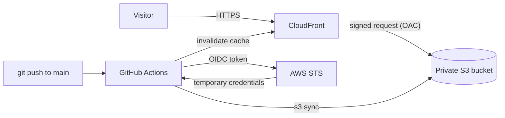

# Portfolio on AWS

A static portfolio site served from a private S3 bucket through CloudFront, with all infrastructure defined in Terraform and deployed by GitHub Actions without any stored AWS credentials.

**Live:** https://d2mscfs9lp8hqf.cloudfront.net

## Architecture



## How it works

1. The site files live in a **private** S3 bucket with Block Public Access on.
2. **CloudFront** serves them over HTTPS and caches copies at edge locations.
3. **Origin Access Control (OAC)** lets CloudFront sign its requests to S3. The bucket policy allows `s3:GetObject` only for requests coming from this one distribution, so the bucket cannot be read directly.
4. On every push to `main` that changes `site/`, a **GitHub Actions** workflow assumes an IAM role through **OIDC**, syncs the files to S3, and invalidates the CloudFront cache.

## Design decisions

| Decision | Why |
|---|---|
| Private bucket + CloudFront + OAC | A public bucket website endpoint is HTTP only, gives no control over access, and is a common source of leaks. |
| Bucket policy condition on the distribution ARN | Without it, any CloudFront distribution in any account could read the bucket (confused deputy problem). |
| OIDC instead of an access key in GitHub | No long-lived credential to leak. The role hands out temporary credentials that expire. |
| Trust policy pinned to the exact repo and branch | GitHub issues valid tokens to every repository. The `sub` condition limits the role to this repo's `main` branch, and uses GitHub's immutable numeric owner and repo IDs. |
| Least-privilege deploy role | It can list and write one bucket and invalidate one distribution. Nothing else. |
| Terraform owns infrastructure, the pipeline owns content | Two tools managing the same object would overwrite each other. |
| No WAF | A static site behind a private bucket has a small attack surface, and WAF adds recurring cost. Shield Standard is included with CloudFront. |

## Repository layout

```
site/                  the website (index.html)
terraform/             infrastructure as code
  providers.tf         AWS provider, default tags
  variables.tf         region, bucket name, GitHub repo and OIDC subject
  s3.tf                bucket and public access block
  cloudfront.tf        distribution and origin access control
  bucket_policy.tf     policy allowing only this distribution
  github_oidc.tf       OIDC provider, deploy role, deploy permissions
  outputs.tf           domain, distribution ID, bucket, role ARN
.github/workflows/     deploy pipeline
```

## Deploy it yourself

1. Install Terraform and the AWS CLI, then sign in (`aws login`).
2. In `terraform/`, set `bucket_name`, `github_repo`, and `github_subject` for your own account and repo.
3. Run `terraform init`, `terraform plan`, `terraform apply`.
4. In your GitHub repo, add repository **variables** `AWS_DEPLOY_ROLE_ARN`, `BUCKET_NAME`, and `DISTRIBUTION_ID` from `terraform output`.
5. Push a change under `site/` and watch the Actions tab.

## Cost

CloudFront and S3 are pay-as-you-go. At portfolio traffic the bill is small, and a budget alert is set on the account. No NAT gateways, load balancers, or WAF are used.

## Tear down

The pipeline uploads files that Terraform does not track, so empty the bucket first or the destroy will fail:

```bash
aws s3 rm "s3://<bucket-name>" --recursive
cd terraform && terraform destroy
```

## What I learned

- A role has no credentials of its own. Something assumes it and gets temporary ones, which is why trust policies and permissions policies are separate.
- GitHub's OIDC `sub` claim now carries numeric owner and repository IDs. I found this by printing the token claims when the first role assumption failed.
- `terraform plan` before `apply` caught a handover that would have deleted the live page, which a `removed` block with `destroy = false` avoided.
- Console settings and Terraform produced identical distribution configs, but only the code is repeatable and reviewable.

## Known limitations and next steps

- `index.html` embeds its images, making it large. Moving images out lets CloudFront cache them separately.
- Terraform state is local. A team setup would use a remote backend (S3 with locking).
- No custom domain yet (Route 53 and ACM).
- Workflow actions are pinned to major versions, not commit hashes.
