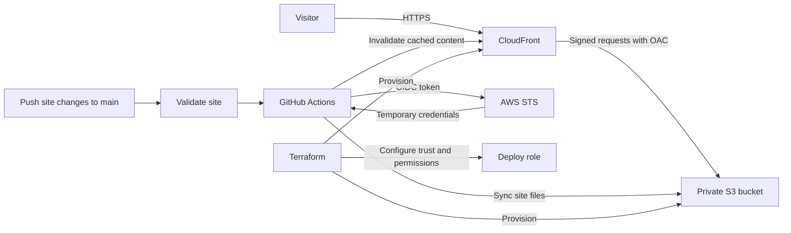

# Muziwakhe Zulu · Engineering portfolio

Full-stack engineering, AI integrations, and cloud delivery. This portfolio presents my professional work and is itself an infrastructure project: a static site on AWS with private S3 storage, CloudFront delivery, Terraform, and GitHub Actions OIDC deployment.

[View the portfolio](https://d2mscfs9lp8hqf.cloudfront.net) · [LinkedIn](https://www.linkedin.com/in/muziwakhe-zulu/) · [Email](mailto:mzulu2204@gmail.com)

## Selected professional work

- **InvoiceIQ:** multi-tenant invoice extraction with FastAPI, React, Claude/Gemini, Celery/Redis, PostgreSQL Row Level Security, Docker, and Azure deployment. Private source repository.
- **PriceWatch:** React/TypeScript retail intelligence with nine AWS Lambda handlers, Cognito-authenticated API Gateway, Bedrock streaming reports, AWS CDK, and GitHub Actions.
- **Enterprise HRIS at Zimworx:** phased delivery, recruitment/CRM/employee integrations, SSO, workforce reporting, and Terraform-managed AWS infrastructure. Proprietary implementation.

These are professional projects, separate from this repository. This repository contains the portfolio and its AWS infrastructure.

## What this repository demonstrates

- Semantic, responsive HTML/CSS with keyboard focus states, a skip link, reduced-motion support, and a print layout. No JavaScript is required to use the site.
- No framework runtime, package dependencies, external fonts, or build step. The application screenshot is a separately cached asset rather than embedded base64.
- A private S3 bucket with Block Public Access and CloudFront Origin Access Control (OAC).
- Infrastructure as code and short-lived AWS deployment credentials through GitHub OIDC.
- Automated checks for broken local assets and fragment links before deployment.

## Preview and check locally

Requires Node.js 22 or later. No dependency installation is needed.

```sh
node scripts/check-site.mjs
node scripts/preview.mjs
```

Open [localhost:4173](http://localhost:4173). Stop the preview with Ctrl+C. The server binds only to loopback.

## Architecture



CloudFront signs origin requests; the bucket policy restricts reads to the distribution ARN. The deployment role can list the site bucket, write/delete its objects, and invalidate this distribution. Terraform owns infrastructure; the deployment workflow owns site content.

## Repository layout

```text
site/
  index.html            Portfolio content and metadata
  styles.css            Responsive design and print styles
  assets/               Application screenshot and favicon
scripts/
  check-site.mjs        Dependency-free local reference checks
  preview.mjs           Loopback-only static preview
terraform/              S3, CloudFront, OAC, IAM/OIDC, outputs
.github/workflows/      Pull request validation and deployment
docs/
  content-guide.md       Content maintenance and accuracy notes
  github-profile.md      Optional GitHub profile README copy
```

## Deploy to your AWS account

Requires Terraform, AWS CLI, and an authenticated AWS identity with permission to provision the resources. Review all Terraform inputs and the plan before applying.

1. Set `bucket_name`, `github_repo`, and `github_subject` in your own local `.tfvars` file. Use a globally unique bucket name. The supplied OIDC subject is specific to this repository; set the **exact subject emitted by your own GitHub configuration**. `github_repo` is descriptive and does not construct or restrict the trust policy; `github_subject` is the enforced condition.
2. Run `terraform init`, `terraform plan`, and `terraform apply` inside `terraform/`.
3. Set GitHub repository variables `AWS_DEPLOY_ROLE_ARN`, `BUCKET_NAME`, and `DISTRIBUTION_ID` from `terraform output`.
4. Push changes under `site/` or the validation script to `main`, or run the deploy workflow manually. Pull requests validate without AWS credentials.
5. Use the `cloudfront_domain_name` output for your site URL. Update the canonical and Open Graph URLs in `site/index.html` if hosting a copy.

Deployment uses `s3 sync --delete`, so the destination bucket must be dedicated to the site. Do not store unrelated objects in it.

## Design decisions and limits

- **Private origin:** S3 is not exposed as a public website endpoint. CloudFront handles HTTPS and edge caching.
- **OIDC:** the trust policy checks audience and exact subject. No long-lived AWS access keys are stored in the workflow.
- **Buildless frontend:** small operational footprint, readable source, and no client-side hydration or package supply chain for the page.
- **Local Terraform state:** current configuration has no remote backend. For shared infrastructure management, configure a protected remote backend and state locking. Never commit state or credentials.
- **Action versions:** workflows currently use major-version tags. Pin reviewed commit SHAs for stronger supply-chain controls.
- **Domain and cost:** uses a CloudFront domain; no custom domain or ACM certificate is configured. S3 and CloudFront incur usage-based charges. This repository does not provision a budget alert or WAF.

## Content maintenance

See [the content guide](docs/content-guide.md) for dates, claim wording, and update rules. Keep private employer code and personal documents outside the public repository. Education year ranges do not assert that a degree has been awarded.

## Tear down

Deleting the infrastructure removes the live site. First empty **only your dedicated portfolio bucket**, then run `terraform destroy` from `terraform/`. The pipeline uploads objects that Terraform does not track, so destroying a non-empty bucket will fail. Verify the AWS account and bucket before deletion.

## Reuse

No license has been added. Ask before reusing personal content, screenshots, or source; linked professional projects have their own terms.
